<p align="center">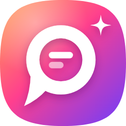</p>

<h1 align="center">Oley</h1>
<p align="center"><b>Turn whatever's playing on Spotify into a live lyric edit.</b><br>17 animated lyric styles · full screen, in a window or as your wallpaper · free and open source · Windows</p>

<p align="center">
  <a href="https://github.com/Aguywithnoname/Oley/releases/latest"></a>
  <a href="LICENSE"></a>
  <a href="MAKING-MODES.md"></a>
</p>

<p align="center">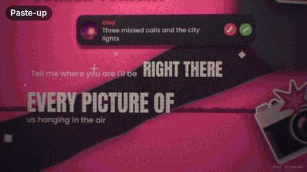</p>

I saw reels on Instagram of an app that showed lyrics like an edit, so I made my own. It took four weeks and a lot of attempts with Claude, it's open source, and you can add your own styles too (also with Claude).

Oley follows Spotify (or any player) through Windows' media controls, finds synced lyrics and plays them as moving pictures: paper paste-up edits, a 3D desk with a phone and a typewriter, chrome fan-edit titles, ASCII art with 120 3D scenes, voxel worlds, a text-message thread, code typed in macro and more. Each style takes its colours from the album cover and hits harder on the key words and the beat.

## Install

1. Download **`Oley-Setup.exe`** from the [latest release](https://github.com/Aguywithnoname/Oley/releases/latest) and run it. It installs for your user only, no admin needed.
   - Windows may say *"Windows protected your PC"* because the app isn't code-signed (signing costs money). Click **More info → Run anyway**.
2. Play a song in the **Spotify desktop app**. Oley follows it through Windows' media controls, the same place the volume flyout reads from. No Spotify login is needed.
3. Press **Ctrl+Alt+L** for full screen, or open Oley from the tray to pick a style.

The first time the settings open, a short tour shows you around. Uninstall from *Settings → Apps* like any other app.

<details>
<summary><b>Run from source instead</b> (Python 3.10+)</summary>

1. **Code → Download ZIP**, unzip it anywhere, and double-click **`Start Oley.bat`**.
2. The first run makes a private Python environment in the folder and downloads the libraries (about 150 MB). If Python is missing, the script opens the Microsoft Store page for it.
3. After that, start Oley from the Start menu or with `Oley.pyw`. Running `Start Oley.bat` again updates the libraries.

</details>

## A look at the styles

| | | |
|:-:|:-:|:-:|
| 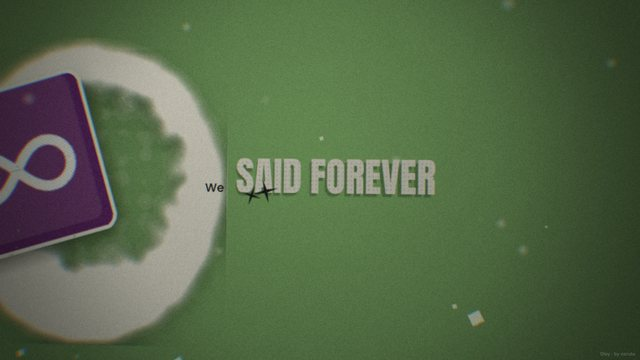<br>**Paste-up** | 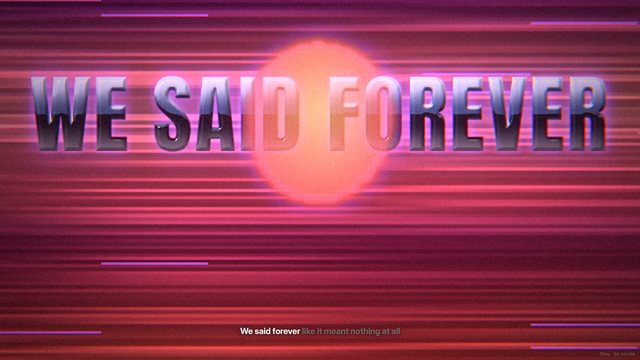<br>**Polyester** | 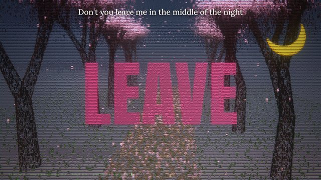<br>**ASCII** |
| 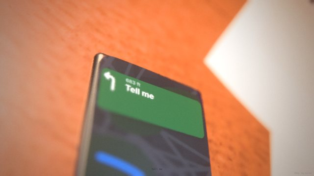<br>**Editlyric** (3D desk) | 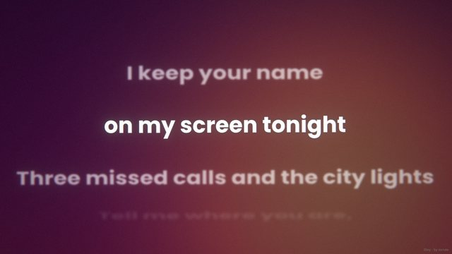<br>**Glass** | 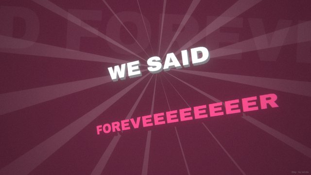<br>**Warp** |
| 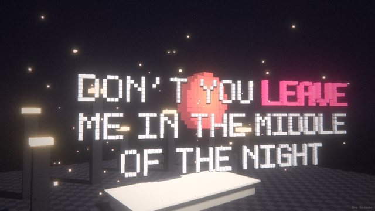<br>**Voxel** | 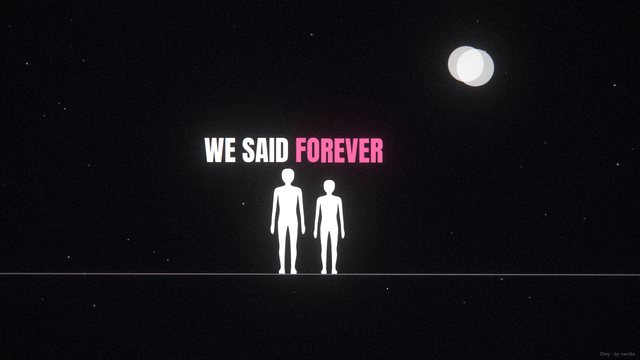<br>**Shadowplay** | 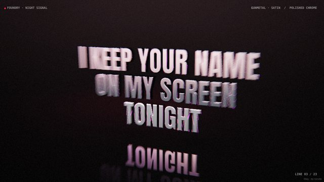<br>**Foundry** |
| 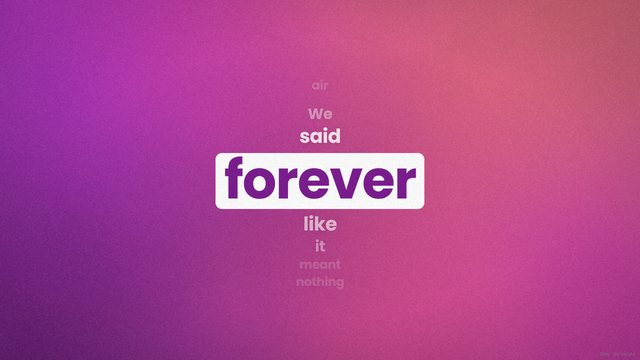<br>**Stack** | 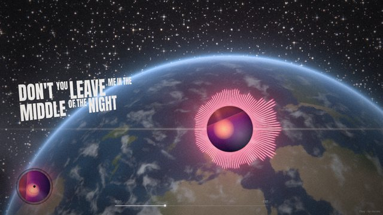<br>**Orbit** | 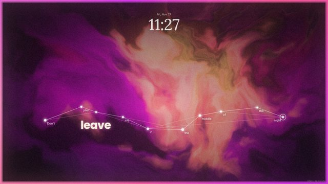<br>**Constellation** |
| 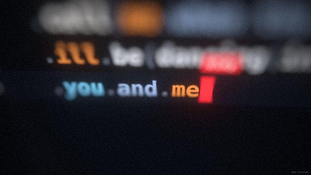<br>**Source** | 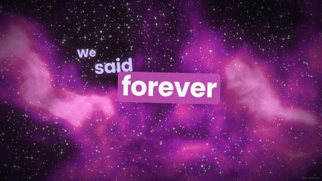<br>**Nebula** | 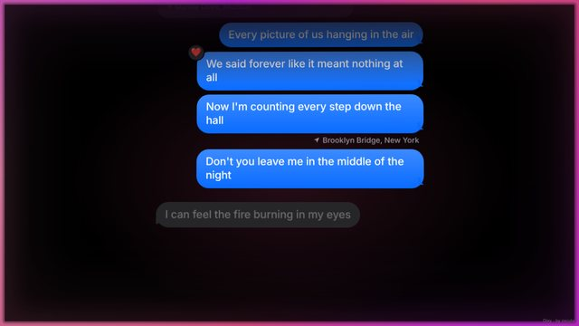<br>**Messages** |
| 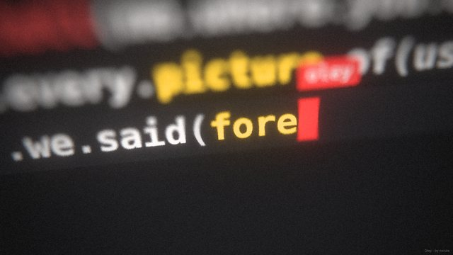<br>**Motion** | 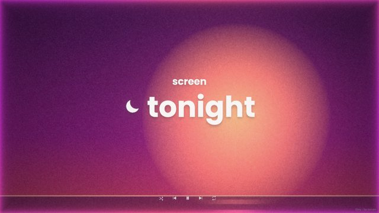<br>**Afterglow** | |

*Shown with Oley's built-in demo song. With your music, every style takes its colours and cut-outs from the song's cover.*

## The modes

| Mode | What it does |
|---|---|
| **Auto** | Picks a mode that fits each song's mood (sad, tender, hype, angry, neutral). Choose which modes it may pick. |
| **Constellation** | Each sung word becomes a star over the blurred cover. Lines join them into a star map, a crosshair follows the voice, and the line's key word blooms large. Has a lock-screen clock and writes the artist and title into the sky. |
| **Source** | The song is typed live as code by a cursor carrying the artist's name, filmed in macro by a floating camera with a wide-open lens, so only the line being typed is sharp. Words open little phone cards (an incoming call, the recents list with "no answer", a hidden photo album, a group-chat message, a search pill) and the focus pulls to them. Fire words light a lighter flame, lies glitch. The cover flies through the lens at the start and back out at the end. |
| **Orbit** | A whole Earth seen from space (oceans with sun glint, continents, clouds, a thin bright atmosphere) under a real starfield. The cover hangs in front of it, ringed by a sunburst of spectrum bars that move with the beat, and the words race in as heavy tilted capitals. |
| **Stack** | One big word at a time on a silky gradient made from the cover. The word before sits small above it, the next ones wait below, and key words get a highlight box. |
| **Nebula** | Big rounded words cascade through a deep-space emission nebula (coloured by the cover) with dark dust lanes and real stars, while neon comets streak past. |
| **Messages** | The song as a text conversation: typing dots, grey and blue bubbles lighting up word by word, location tags, map cards, heart tapbacks and read receipts. |
| **Polyester** | The song cut like a fan edit, with the cover as the footage. The cover's subject is cut out and held while the world behind it rushes past; hard cuts land on the words and the beat; white flashes, sliced wipes, radial zoom blur and RGB shake; punch-ins on the face, tilted and black-and-white shots, a split screen, lightning arcs and a glowing aura behind the subject. Every phrase hits as a giant chrome title behind the subject, and the song ends on an extreme close-up. Covers without a clear subject become a floating card instead. |
| **Motion** | The song typed as code and shot like an edit: a camera rides the cursor in close-up with shallow focus, whips to every new line with motion blur and colour fringing, snaps back to show the whole file, punches in on the key words (they glow yellow), selects everything at the end of a section, clicks into new lines and ends on a title banner. Two named cursors share the typing: verses are the artist's, the hooks are "you". |
| **Afterglow** | The cover fills the screen and the words stack over it: the one being sung big in the middle, the one before small above, the next small below, with little icons for words like "left", "city" or "started", player controls at the bottom and a rim of light around the screen. In long instrumental breaks and at the end the camera pulls back and it turns out to be a monitor glowing in a dark room. |
| **Editlyric** | Now a real 3D room rendered on your graphics card: a desk with a phone, a laptop, a typewriter, paper, a book, a receipt printer and a lamp, a neon sign, a cork board, a TV and a rainy window. Every line plays on one of those objects while the camera flies between them with real motion blur, depth of field and film grain (switch it off in the settings for the older flat scenes). Every line becomes its own little scene, and a scene doesn't come back until most of the others have played. **On a phone** (floating, lying on a table, or as a close-up that follows the action): typing on the keyboard with suggestions, lock-screen notifications, an incoming call, an alert, search, a checklist, a story with text stickers, a voice memo with a live transcript, turn-by-turn navigation, the weather, a timer, a post and a passcode. **On a computer**: a cascade of error dialogs (modern or retro), a spreadsheet, a terminal, a file dragged to the trash, a copy in progress and a command-bar search. **Real things**: a split-flap departure board, a receipt printing, a neon sign on brick, a typewriter, sticky notes on cork, a highlighter on a book page, letters wiped into a fogged window, a label maker, a ransom note, a rubber stamp, letter tiles on a game board, a slot machine, a boarding pass, a newspaper front page, an LED ticker, a highway sign at dusk, a heart monitor, a stock chart, Morse code on a paper tape and a fortune card turned over. **Moving type**: falling words that pile up, a magnifying glass, a tunnel of words, a pane of glass that shatters on the key word, a Swiss poster and a film still with subtitles. Scenes are matched to the words where they can be ("call" can ring, "rain" can rain, "leave" can hit the departure board), and every line also gets its own camera move and transition. Each play of a song gets a different edit. Instrumental breaks show a now-playing card, the clock, or a glowing spectrum. A few classic scenes from the first version turn up now and then (at most once per song), and a setting turns them off. A small typewriter caption keeps the words readable. |
| **Pasteup** | A moving paste-up. Every word or short phrase gets its own composition: huge condensed type cropped by the frame, script and blackletter, ransom-note letters, the cover's subject cut out in two inks or halftone dots, stickers, tickets, road signs, scribbled circles and arrows, a design-tool selection box, fanned polaroids with the line handwritten on them, a record spinning under the light, a cassette with turning reels, a tabloid front page, letter blocks flipping up, misregistered inks locking into place, a tunnel of frames, a sticker bomb, a Swiss grid poster, a taped photocopy and a halftone wall (29 compositions in all). One colour scheme per song (and a new one each play), layouts that don't repeat close together, and the change from one composition to the next happens inside the picture (whips, push-throughs, sheets sliding over, smears), on the GPU with real motion blur. Some verses become a collage scroll instead: the lines build up as one long poster in coloured paper (a small lowercase lead-in, the key words huge and condensed), the camera eases down to follow each new line, torn sheets and cut-outs slide in at different depths, a call line can arrive as an incoming-call banner that types itself out, and the camera pulls back over the whole sheet before a break (Mixed in, Every verse or Off in Settings). Each section of the song is printed in its own scheme, and layouts, cuts and camera moves are dealt from shuffled decks so the same one doesn't come back until the rest have had a turn. Some layouts treat the cover's cut-out as code: printed in characters in a terminal while the line is typed, exploded into five prints spaced out in depth, sliced into strips that fly in and lock, a pop-art grid, a scanner that tags each word on it, a mosaic that resolves, green code raining into the figure. When a sung word has an obvious picture ("you know my line" gets a phone, "fire" gets a flame), the emoji is printed into the page as a die-cut sticker, a halftone cut-out, a photocopy or a two-ink riso print. |
| **Foundry** | Every line cast in metal and rendered live on your graphics card, no models or footage: each letter is traced from the typeface into a distance field and extruded with a polished bevel, with a satin or brushed face and a mirror edge (two finishes per song, from chrome, brushed gold, gunmetal, copper, black lacquer, heat-tinted titanium and anodised colour). A small photo studio lights it: one softbox printed with the album cover, two strip lights in the song's colours, a glossy floor. The song directs the camera with a cue script per line (hero, close-up, around, descend, macro, tracking the words); words form as they're sung, a held line opens into an exploded view with callouts, then blows apart as the camera flies to the next. Bloom on the glints only, ACES, grain. |
| **ASCII** | The song drawn in characters, like code art, with a new scene every verse. The cover's cut-out as code (a portrait greyed except for its strongest colour, moving like cloth in wind; green code rain falling into the figure; a binary scanner; the figure exploded into five prints turning in 3D; the cover on a spinning donut or cube), shown briefly so it never sits on the lyric for long. Between covers, 120 hand-built 3D scenes in six themes (flowers, space, cars, cities, oceans and landscapes: lilies opening, a whale breaching, a waterfall, a city in the rain, a launch pad, an aurora over a lake and more), picked by what the verse is about, plus fire, a storm and fireworks. The lyric's emoji pop in as character sprites, the key word rises huge, the line is set as a serif caption with its key word in italics, and scenes change by decoding cell by cell. Character size, the places and the one-colour look are in Settings. |
| **Voxel** | The song as a world made of cubes, rendered live on your graphics card with sun shadows, bloom and fog, and a new place every verse dealt from a shuffled deck: a floating island at sunset with blossom trees and lanterns, a city street at dusk with the words laid on coloured tiles on the road, a checkerboard path through a night sky with aurora, a meadow with a hedge heart seen from above, a ringed planet in space, a gold vault, a neon tunnel, and the album cover rebuilt as a voxel statue that assembles cube by cube or a pixel mural with depth. The camera never stops moving (orbits, fly-throughs, a rush into a storm of cubes between places). Every word is built from blocks that fly together on its syllable, the key word bigger and lit, and the line shatters into falling cubes when the next one comes. All worlds and the block font are drawn for Oley. |
| **Shadowplay** | A silhouette lyric video. Flat figures (the album cover's own cut-out when it's shaped like a person, otherwise figures drawn for Oley) on black, white, red or a sunset; condensed capitals that arrive word by word, grey turning white, with one accent colour. Every line is its own shot: a figure on a horizon that tilts on the key word, a word echoing down the screen, a sunset with rings off the sun, an endless tunnel of squares, two profiles facing that flip black to white, one huge tilted word, a night with a crescent, a hyperspace warp, a heart drawn in one line, a rotary dial, a ring with the words running round it, a sonar target, the line's emoji as a solid shape, two hands reaching up. The shots are joined by camera moves that land on the words: diving into the dark of a figure to come out in the next scene, pulling back out of the sun, a moon or the dial to reveal where we are, whip pans, rolls, white and coloured flash frames with the picture inverted, and glass that cracks and is flown through. The camera's own speed smears the frame (zoom, pan and roll blur) with an RGB split and a lens bulge on the rush. The cover cut-out, the flash frames and the emoji can be turned off in Settings. |
| **Warp** | Cut like a phone-made lyric edit. Each line is its own moment: heavy type that bends (a wave that melts it once the line is sung, an arch, a fisheye, wrapped round a turning cylinder, tipped back in perspective and extruded in 3D) over neon hearts that change colour on every word, halftone dots, light rays and a ring of the lyric turning behind; 3D outlined type stacking up over a bright sky and hill; or the line typed into phone UI: a message bubble that types itself and stretches the long-sung word ("toniiiiight"), a keyboard with the line's emoji repeated, a glowing pill and big humped yellow rows, a file card named after the line, a weather card with one huge thin word, a text selection walking word to word with a spell-check squiggle, a spinner with a caption, label boxes in quotes. The line's emoji as an object with giant letters behind it, a blue tile through a fisheye, the album cover with one word at a time, a CRT gradient with the sound drawn across it. The moments are joined on the words with glitches, a mosaic, a diamond wipe, card flips, zoom punches, whip pans, rolls and flashes, and the camera's own speed smears the frame. Glitches and flashes, emoji and the cover scene can be turned off in Settings. |
| **Glass** | The song as a polished app ad. It opens on a phone working out what's playing: a blue blob on frosted glass, "What song is playing?" typed a word at a time, a few dots, the listening rings breathing with the music, then a result card with the real cover, title and artist, and the camera dives into the cover. The lyrics then run like a music app: the lines scrolling up over the cover blurred into a backdrop, the sung words filling in white, or rolling round a drum. Between runs, a moment of UI carries a line: a search typed in, with track cards and a pointer that clicks one; frosted typing with the newest word in blue; a social post that leans in to box the key word; a curved stage; the title as a search-engine logo and a spinning record with the cover as its label; a call pill growing out of a green dot; a notebook where the line is written and the key word catches fire; a torn-paper iris opening on a pixel word; embers and the key word's letters flying round; an eyeball watching a line arched over it; ghost type; an ink blot; a row of buttons clicked word by word; a map drawing a route with a clock; a phone with an orange ring round it; a cloudy pink sky with the letters dropping in; the title as a logo with brush strokes. Joined by soft-focus dissolves, torn-paper irises, barcode wipes, zooms and the odd glitch. The cover, the glitches and the emoji can be turned off in Settings. |

Every mode reads the song: key words land harder, sad lines get gentler treatment, and the same song always plays out the same way.

## Make your own modes

Every `.js` file in the **`custom-modes`** folder is a lyrics mode. It shows up in Settings with a **Yours** badge, in Cinema, the window and the wallpaper.

- **With AI:** open the Oley folder in Claude Code (or another AI coding tool) and ask, for example: *"Make a new Oley lyrics mode in custom-modes where the lyrics are written in chalk on a blackboard."* `CLAUDE.md` tells the AI how the project fits together.
- **By hand:** copy `custom-modes/_example.js` to a new name and change it. [`MAKING-MODES.md`](MAKING-MODES.md) has the whole mode API: the lyrics timeline, audio, cover colours and the drawing helpers.

You can change the built-in modes too; they live in `web/js/modes`.

## Ways to watch

- **Cinema**: full screen. Press **Ctrl+Alt+L** anywhere to turn it on or off, or use the tray or the settings. Any key or click closes it; moving the mouse doesn't. With two screens, choose which screens show Cinema and give each its own mode (for example Stack on the laptop and Nebula on the monitor). Cinema can also open by itself after a few idle minutes while music plays, like a screensaver, and closes again when you come back.
- **Window**: a normal window you can put anywhere. Double-click or press **F** for full screen, **M** for the next mode, **Space** to play or pause, and the **arrow keys** for previous and next.
- **Wallpaper Engine**: in the settings, under *Wallpaper*, click **Install**. Then in Wallpaper Engine pick **My Wallpapers → Oley Lyrics**. The wallpaper follows the app and has its own mode. If the app isn't running, it falls back to Wallpaper Engine's own media information and fetches lyrics by itself.
- **Glow**: a soft light around the screen edges while you work, coloured by the cover and pulsing with the beat. It hides for full-screen games and videos. Cinema has its own glow, with an optional notch shape.
- **Song card**: when a song starts, a card with the cover, title and controls shows for a few seconds.

## Closing and the tray

Oley lives in the tray. Closing the settings window asks once whether to **Quit** or **Keep running**, with "Don't ask again". You can change the answer later under *System → When I close this window*. **Quit Oley** in the tray or the settings always closes everything within 4 seconds.

If Oley ever crashes, it restarts itself in the tray. Ending it in Task Manager keeps it closed. Starting a newer copy replaces an older one that's still running.

## Lyrics

Synced lyrics come from [LRCLIB](https://lrclib.net) (free, no account). If a song has no synced lyrics, plain lyrics are spread over the song and follow along roughly.

- **Your own lyrics:** put a file named `Artist - Title.lrc` in `data\lyrics\` (*Now playing → Lyrics folder*). It's used instead of LRCLIB.
- **Timing:** if the words run early or late, use *Now playing → Lyrics timing*.

## Privacy

Everything runs on your PC. Oley's pages talk to the app over `127.0.0.1` only, protected by a random key. The only things sent out are lyrics lookups to LRCLIB and cover lookups to the iTunes Search API (*System → Sharper covers*). The cut-out model is downloaded once from GitHub; covers are cut out on your PC and never uploaded. Beat detection listens to your PC's sound output; nothing is recorded or saved.

## Files

Installed, Oley keeps your things in `%LOCALAPPDATA%\Oley\` (*System → Open data folder*). Run from source, they're in the `data` folder next to it.

- `data\oley.log`: the log (*System → Open log*). `data\crash.log` records crashes.
- `data\settings.json`: your settings.
- `data\cache\`: cached lyrics and covers. `data\masks\` holds cover cut-outs and `data\models\` the cut-out model.
- `data\edge\`: the Microsoft Edge profiles that Cinema, the window and the settings run in. Each runs in its own process, so a graphics problem in a page can't take Oley down.

## Troubleshooting

- **Nothing shows as playing:** use the Spotify desktop app, and check that it appears in the Windows volume flyout. To follow other players (browsers, Apple Music…), turn off *System → Only follow Spotify*.
- **Ctrl+Alt+L does nothing:** another app may already use it. The *Cinema & screens* page says so if that happens.
- **No beat in the glow:** *System → React to the music* shows whether the audio capture is running. Run from source? If PyAudioWPatch didn't install, run `Start Oley.bat` again.
- **Something looks stuck:** *System → Reload windows* reloads Cinema, the window and the wallpaper.
- **A mode is slow:** the GPU modes (Polyester, Motion, Source, Afterglow, Orbit, Nebula) follow *System → Performance*. **Light** renders fewer pixels and fewer lens samples. Motion and Source also lower their own quality if frames start dropping.
- **Polyester doesn't cut the person out:** sharp cut-outs come from an AI model that Oley downloads the first time Polyester asks for one (about 170 MB, saved in `data\models\`). It needs onnxruntime, which `Start Oley.bat` installs. Without it, Oley makes its own quick guess, which works on plain backgrounds; busy covers become a floating card instead. You can turn the model off under the Polyester options.

## Requirements

Windows 10 or 11 (64-bit), Microsoft Edge (built into Windows), a graphics card with WebGL 2 (any from the last ten years), and Spotify for Windows. The installer brings everything else; running from source needs Python 3.10+. Libraries: PySide6-Essentials (tray and glow), winrt (media controls), numpy and PyAudioWPatch (beats), psutil, and optionally onnxruntime and Pillow (AI cut-outs). The cut-out model is "isnet-general-use", published by the [rembg](https://github.com/danielgatis/rembg) project.

Bundled fonts (Inter, Anton, Archivo Black, Lora, Poppins under the SIL Open Font License, and DejaVu Sans Mono) are listed in `web/fonts/FONTS-LICENSE.txt`.

Emoji (Pasteup, Shadowplay, Warp, Glass) are Microsoft's [Fluent Emoji](https://github.com/microsoft/fluentui-emoji) 3D set (MIT License) by default. Apple's set is an option in Settings for your own use; those images are Apple's artwork and aren't licensed for redistribution. Neither set is bundled: Oley's local server downloads each emoji the first time a song needs it and keeps it in its data folder under `emoji/`.

## Build the installer yourself

Every published release builds `Oley-Setup.exe` and a portable zip automatically ([`.github/workflows/release.yml`](.github/workflows/release.yml)): PyInstaller makes the app folder ([`packaging/oley.spec`](packaging/oley.spec)) and Inno Setup wraps it ([`packaging/oley.iss`](packaging/oley.iss)). On your own PC:

```
pip install -r requirements.txt PyAudioWPatch onnxruntime Pillow pyinstaller
pyinstaller packaging/oley.spec --noconfirm
"%ProgramFiles(x86)%\Inno Setup 6\ISCC.exe" packaging\oley.iss
```

## Credits and licence

Oley is made by **nxrute** and released under the **GNU General Public License v3.0** (see [`LICENSE`](LICENSE)). You can use it, change it and share it, including your changes, under the same licence.

One extra term applies to every copy and fork (GPL-3.0 section 7(b), see [`NOTICE.md`](NOTICE.md)): keep the name, the logo and the small "Oley · by nxrute" credit visible where the app shows them. The name, logo and credit aren't settings for this reason.

Lyrics come from [LRCLIB](https://lrclib.net). Thanks to everyone behind the fonts, the emoji and the libraries listed above.
